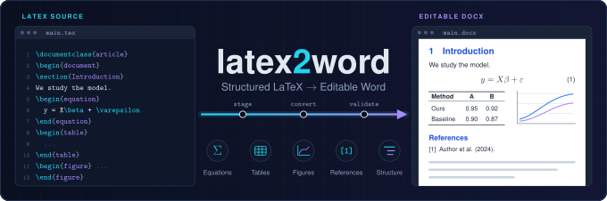

<p align="center">
  
</p>

Convert structured LaTeX projects into editable Microsoft Word documents while preserving equations, tables,
figures, references and document structure.

> **Status: experimental / private preview.** latex2word is under active development. It is not production-ready,
> its configuration format may still change, and no licence has been chosen yet: all rights reserved by the
> owner until a licence is added. Output must be reviewed in Microsoft Word.

> **Trust boundary.** latex2word currently assumes trusted LaTeX input. Do not use it to process untrusted or
> third-party LaTeX projects. See [SECURITY.md](SECURITY.md) for what is and is not enforced.

## Why

Journals, institutions and collaborators often require `.docx`. Generic converters flatten LaTeX: equations become
images, tables lose their structure, numbering and cross-references turn into stale text, and page layout is lost.
latex2word treats the LaTeX project as the source of truth and produces a Word document that people can keep
editing: native Word equations, real Word tables, vector figures, working internal links and Word-native contents
lists.

It is a careful pipeline around Pandoc, not a TeX engine. latex2word is designed to fail loudly on unsupported
constructs: it probes for commands Pandoc would drop, applies structural validation to the result (for example a
per-occurrence check that every source cross-reference reached the document, and that no alignment marker leaked into
an equation), and refuses to write output when a check fails. These checks cover the failure modes that are known
and tested; they cannot prove that every possible TeX construct is converted.

## Validation

- **Test suite**: synthetic fixtures only; `python -m pytest` passes completely on Windows 11 with Pandoc 3.12 and
  3.13 (counts in [docs/development.md](docs/development.md)).
- **End to end**: the maintainer has validated the current version on a private 163-page engineering report, rendered by
  Microsoft Word: 163 Word pages, 1,405 native equations (54 display), 21 captioned figures and 2 logos, 31
  captioned tables, 47 figure/table notes, 74 bibliography entries, 486/486 cross-references resolved, roman/arabic
  page-number sections and Word contents fields; the LaTeX sources stay byte-identical. That document is not part of
  the repository.

## Features

- **Equations**: native, editable Word equations (OMML), inline and display; numbered equations laid out with the
  number at the margin; `\eqref`.
- **Tables**: real Word tables from `tabular`, `tabularx`, `longtable` (repeated header rows, final notes),
  `\multicolumn`, booktabs rules, custom column types from `\newcolumntype`; tables taller than a page can break.
- **Figures**: TikZ, circuitikz and pgfplots (including external data files) rendered to vector graphics; PDF and
  SVG graphics converted to vector images; widths resolved against the page or column.
- **Units**: siunitx (`\SI`, `\si`, `\num`, `\SIrange`, `\qty`, `\sisetup`, `\DeclareSIUnit`) converted to text
  and math.
- **Cross-references and numbering**: `\ref`, `\eqref`, `\autoref`, `\cref`/`\Cref` with profile-controlled
  numbering formats and working internal hyperlinks; appendices.
- **Bibliography**: BibTeX/biblatex sources rendered through Pandoc citeproc with a CSL style; inline
  `thebibliography`; citation keys verified before conversion.
- **Contents lists**: Word TOC, list of tables, list of figures and tocloft custom lists (`\newlistof`); manual
  `\addcontentsline` entries; starred headings kept out of the TOC; profile-controlled entry styles.
- **Academic pagination**: `\pagenumbering{gobble|roman|arabic}` becomes Word sections with restarted page
  numbers; blank and title pages; `\clearpage`.
- **Front matter**: title pages with relative font sizes, `\vspace`, `\hrulefill` signature lines; `\title`/
  `\author`/abstract/keywords through profile metadata adapters.
- **Figure and table notes**: note blocks attached to floats keep their source formatting as a Word style.
- **Profiles**: page geometry, columns, typography and numbering live in YAML profiles (`generic`,
  `ieee-conference`, or your own), never in the engine.
- **Safety (trusted input)**: the LaTeX project is never modified; all work happens in an owned, staged copy; the
  output can never replace a build input or a non-DOCX file; it is replaced atomically only after validation. These
  are safety properties for trusted projects, not a sandbox (see [SECURITY.md](SECURITY.md)).

## Requirements

- Python 3.11 or later (developed with 3.14) and the Python packages `PyYAML`, `jsonschema`, `lxml`.
- External tools (found on `PATH`, never installed by latex2word): Pandoc 3.12 (certified), a TeX distribution
  (`latex`) and `dvisvgm`. Optional: `pdftocairo`, Inkscape, `rsvg-convert`. Pandoc 3.13 passes the same tests but
  is reported as `TESTED_UNCERTIFIED`; every build probes the Pandoc in use and refuses one whose LaTeX reader
  differs from the pinned facts (e.g. 3.1.3).
- Microsoft Word to view and review the result (Word is the authoritative renderer).

Details: [docs/dependencies.md](docs/dependencies.md). Platforms: developed and validated on Windows 11; Linux/WSL
is a design target but not regularly validated.

## Installation

```bash
python -m venv .venv
# Windows: .venv\Scripts\activate    Linux/macOS: source .venv/bin/activate
python -m pip install -e ".[dev]"     # or without -e and [dev] for a plain install
latex2word doctor                     # checks Pandoc, TeX and the figure tools
```

## Usage

A project is described by a small YAML file:

```yaml
schema_version: 1
project: {name: my-report, root: ., main: main.tex}
profile: generic                 # or ieee-conference, or a custom profile
profile_dirs: [profiles]         # optional: directories with custom profiles
output: {directory: output}
```

```bash
latex2word config validate project.yaml   # check the configuration
latex2word inspect project.yaml           # read-only: dependencies, bibliography, figures
latex2word figures project.yaml           # render TikZ/PDF figures to SVG (no conversion)
latex2word build project.yaml             # convert to DOCX; writes output/main.docx
latex2word build project.yaml --json      # machine-readable result
```

Exit codes: `0` success, `1` document problems (see the diagnostics), `2` configuration, profile or tool error.
Each build writes a workspace with the staged copy, the transformation log, a build manifest, a layout report and
a `visual_review.md` checklist for the Word review.

## Documentation

| Document | Content |
|---|---|
| [SECURITY.md](SECURITY.md) | trust boundary: what is and is not enforced |
| [docs/architecture.md](docs/architecture.md) | pipeline and modules |
| [docs/supported-latex.md](docs/supported-latex.md) | supported constructs and caveats |
| [docs/known-limitations.md](docs/known-limitations.md) | known limitations |
| [docs/dependencies.md](docs/dependencies.md) | required, optional and development dependencies |
| [docs/development.md](docs/development.md) | environment, tests, fixtures, workflow |
| [docs/m4-layout.md](docs/m4-layout.md), [docs/equation-layout.md](docs/equation-layout.md), [docs/pandoc-ast-findings.md](docs/pandoc-ast-findings.md) | design notes |
| [tools/README.md](tools/README.md) | manual verification helpers (Word rendering, PDF line metrics) |
| [examples/minimal-project.yaml](examples/minimal-project.yaml) | a commented project file |
| [reports/audit/](reports/audit/) | independent code audit: findings, fixes and remaining risks |

## Known limitations (summary)

- Bibliography formatting follows the CSL style, which can differ from a biblatex style; a declared style
  (`style=apa`, `\bibliographystyle{…}`) without a matching CSL is reported as a warning.
- Figure, table and equation numbers and cross-reference texts are literal text with working hyperlinks, not Word
  `SEQ`/`REF` fields.
- Very wide equations can render differently because Word's math metrics differ from TeX's.
- Not every macro or package can be reproduced semantically; unknown constructs that would lose text are errors.
- Microsoft Word is the authoritative renderer; final layout must be reviewed there.
- latex2word assumes trusted LaTeX input: Pandoc's reader can still be steered outside the project by a
  `filecontents` construct (an opt-in confined reader closes this), and TeX can read any readable file while
  rendering a figure. See [SECURITY.md](SECURITY.md).

See [docs/known-limitations.md](docs/known-limitations.md).

## Tests

```bash
python -m pytest                    # unit and synthetic end-to-end tests (Pandoc tests skip without Pandoc)
python -m pytest -m integration     # optional: real toolchain and external reference projects (env-configured)
```

The suite passes completely with Pandoc 3.12 and 3.13; figure tests use fake tool runners and need no TeX. With a
Pandoc that fails the compatibility probe, the build tests stop at the compatibility check by design. The integration
tests are deselected by default and need an external project and a local expectations file (see
[docs/development.md](docs/development.md)).
