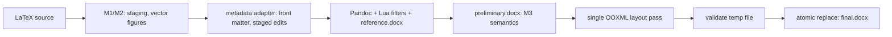

# M4: profile-driven Word layout and front matter

latex2word is not an IEEE formatter. The architecture is

```
generic conversion engine + semantic profile + layout profile + optional metadata adapter
```

IEEE Conference is the first integration test of that architecture. Nothing in the engine
branches on a publisher or a document class; publisher knowledge enters only as profile
data (`src/latex2word/profiles/*.yaml`) and registered adapters (`metadata/ieee.py`). A guard
test (`tests/test_architecture.py`) fails if publisher-specific code appears in a generic module.

## Pipeline



`finalize_docx` (`ooxml/finalize.py`) loads the preliminary package once, applies every
transform on in-memory trees, writes a temporary sibling, validates it (OPC, all M3 semantic
checks, layout checks) and only then replaces the destination atomically. The preliminary DOCX is
never modified, and a failed finalisation leaves a previous output byte-identical.

Transform order: styles (missing ones only) -> body start -> front matter -> bibliography ->
caption placement -> figure extents -> table layout -> equation layout -> section properties -> core
properties.

## Reference document

`reference_doc.py` obtains Pandoc's own default `reference.docx` (`pandoc --print-default-data-file`),
treats it as an OPC package, rewrites its `styles.xml` from the resolved profile typography and its
section properties from the page geometry, and writes a deterministic zip (fixed timestamps; core
properties from `SOURCE_DATE_EPOCH`) to `<ws>/build/reference/reference.docx`. Pandoc's installed data
is never modified, and Word/LibreOffice are not needed. The same Pandoc version + profile + latex2word version
give the same bytes; the hash is in the build manifest. `reference_docx: {mode: external, path: ...}`
uses a user-supplied template instead: it is read, never written; only *missing* required styles are
added to the workspace copy, existing styles are untouched.

Styles are addressed by `w:styleId` (`ooxml/style_ids.py`), never by display name. Named styles carry
the formatting; direct formatting is used only where structure requires it (table widths, section
properties, drawing extents, tab stops). The validator reports the direct-formatting ratio.

## Geometry

Lengths are exact EMU (`units.py`); twips appear only when writing Word values. Column width =
`(text width - gap * (n - 1)) / n`. In a two-column IEEE section: `(7.25 - 0.25) / 2 = 3.5 in`, so
`0.98\columnwidth = 3.43 in`, derived from the profile rather than hard-coded.
`\columnwidth` and `\linewidth` resolve to the column width of the section the figure is in,
`\textwidth` to the page text width (`textwidth_basis: page-text`): `0.5\textwidth` in a two-column
section is 3.625 in, wider than a column, so it is clamped to the column with `L2W-W-LAYOUT-011`
(`allow_overflow: false`). The SVG/PNG assets are never regenerated or rasterised; only the Word
extents change, aspect ratio preserved.

Sections: the front matter and body are two sections only when their column counts differ. The
break is a continuous section break carried by the last front-matter paragraph; the body start
is derived from structure (`first-numbered-heading`: the first level-1 heading carrying the
semantic number the filter assigned), never from heading text, and no marker text is written.

## Front matter and metadata adapters

`metadata/model.py` is publisher-neutral (`DocumentMetadata`, `Author`, `Affiliation`).
Adapters are chosen by the profile (`frontmatter.metadata_adapter`):

* `generic`: `\title`, `\date`, `\author{A \and B}` (lines: name, affiliation, e-mail), keyword
  commands/environments named by the profile;
* `ieee-author-blocks`: `\IEEEauthorblockN/A` (concatenated or `\and`-separated) and `\parbox`
  author columns; without those constructs it reads the author exactly like the generic adapter.

Adapters remove the consumed `\author{..}` from the *staged copy*, rewrite keyword commands to the
configured keyword environment, and report the commands they consumed. Unicode accents are preserved
exactly. Content an adapter cannot convert exactly is an error (`L2W-E-META-002`), never dropped.
Title, abstract and keyword text come from Pandoc's rendering, so math stays native OMML; the
label and punctuation (`Abstract--`, `Index Terms--`) come from the profile.

## Fail-closed unknown TeX

Pandoc silently drops unknown commands together with their arguments. Default policy: an unknown
command that carries text is `L2W-E-TEX-001` (error) unless it is known safe, accepted by the
profile (`tex.accepted_*`), consumed by the selected metadata adapter, or allowed explicitly by the
project (`tex.allow_commands/allow_environments`). Citation/reference commands remain hard errors.

## Equations

The numbered display equation and its number paragraph become one borderless three-cell table
(equation centred in the middle cell as native OMML, number right-aligned, equal side cells so the
equation is centred independently of the number's width). See `docs/equation-layout.md` for the
comparison with tab stops and Word's native `#` numbering. Word rendering of this is
`MICROSOFT_WORD_REVIEW_REQUIRED`.

## Word numbering fields (investigated, deliberately deferred)

Converting the literal numbers into `SEQ Figure/Table/Equation` and `REF` fields was investigated and
not implemented in M4: the semantic numbering (Roman tables, per-profile formats, citeproc, unnumbered
headings) is computed deterministically by the Lua filters and already validated; fields would
add Word-side recomputation that can disagree with it (and `w:fldChar` caching must be exactly right
or Word shows errors on open), without any benefit to the M4 goals. Numbers stay literal text with
working internal hyperlinks and bookmarks. Native fields are deferred to M5+, which can reuse the
cached-result approach (`SEQ` result text = the literal number, bookmarks unchanged).

## XML library decision

M4 adds `lxml` as an explicit runtime dependency, used for all OOXML parts (the pass and
`docx_validate.py`); `svg_validate.py` keeps the stdlib parser for SVG, a separate domain. Concrete
operations where `xml.etree` is unsafe or awkward:

* namespace-preserving round trips: ElementTree drops unused namespace declarations and renames
  prefixes, which breaks `mc:Ignorable="w14 w15"` in Word-authored external reference templates;
* parent/sibling navigation (`getparent`, `addprevious`, `itersiblings`) for moving paragraphs into
  table cells and carrying section breaks, which ElementTree lacks;
* XPath and ordered insertion into schema-sequenced property containers.

## Diagnostics (new)

| Code | Meaning |
|---|---|
| `L2W-E-TEX-001` | unknown command whose text would be lost |
| `L2W-E-META-001..004` | author content not understood / no author extracted / keyword config |
| `L2W-E-REFDOC-001..006` | reference document problems |
| `L2W-W-LAYOUT-011/012` | figure clamped to the column / aspect mismatch |
| `L2W-W-LAYOUT-020..022`, `E-023` | table fit, width clamp, font floor |
| `L2W-W-LAYOUT-031/032` | equation layout space |
| `L2W-E-LAYOUT-060/061` | body start not found / finalisation failed |
| `L2W-E-LAYOUT-070..090` | final layout validation (page, margins, sections, columns, front matter, figures, tables, equations, styles, schema order); `W-088` direct-format density |

## Known limitations

See the README. Everything a rendering would decide is listed in `visual_review.md`.
